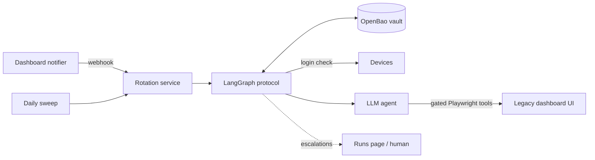

# Legacy Password Rotation Agent

An LLM agent that rotates device passwords through a legacy web dashboard that has no API, and is built so that it **never loses a password**, even if the process dies halfway through a change.

The problem comes from a system design interview: a supermarket's refrigeration devices each have an admin password that staff must rotate every 6 months. The devices are managed through an old web dashboard. There is no API, no MCP server, and building one is not allowed. A notification system says when a rotation is due.

This repository simulates the dashboard, the devices and the notifier, and builds the agent and its safety system around them.

## How it works



- **Code owns the safety steps. The LLM only operates the web page.** The rotation is a fixed LangGraph state machine. The LLM is called inside one step, with six tools.
- **The LLM never sees a password.** It types `{{NEW_PASSWORD}}` and `{{CURRENT_PASSWORD}}`. Code puts the real value in at the moment of typing. Passwords never appear in prompts, graph state, checkpoints, logs or traces, and a test checks it.
- **The agent's word is not trusted.** Risky clicks pass a code gate first, and the result is checked by logging in to the device directly afterwards.

## Never losing a password

The protocol writes the new password down before using it, and keeps the old one until the new one is proven to work (the same idea as a database's write-ahead log).

| Step | What happens | If it fails |
|---|---|---|
| 1. Lock | Take a lock on the device in the vault (check-and-set, so only one run wins) | Another run holds it: skip |
| 2. Pre-check | Log in to the device with the stored `active` password | Escalate: the vault is already wrong |
| 3. Escrow | Generate a password with the device model's policy and store it as `pending` | Stop: the device was not touched |
| 4. Change | The agent changes the password in the dashboard | Go to verify anyway |
| 5. Verify | `pending` must work on the device and `active` must not | Retry the change twice, then escalate |
| 6. Commit | `pending` becomes `active`, the old one becomes `previous` | Escalate; `pending` still works |
| 7. Unlock | Release the lock | |

**Invariant:** at every moment, at least one password stored in the vault works on the device.

**Recovery.** Each run is checkpointed to SQLite after every step, and every step is safe to repeat. After a crash, the run resumes from its last checkpoint. If the checkpoint is lost too, the vault still says `pending`: the daily sweep finds it, tries `active` and `pending` on the device, and keeps whichever works. An unused `pending` is never deleted: it is kept as `abandoned`, and before calling anything an incident the protocol also tries `abandoned` and `previous`, so a change that lands late still can't strand the device.

**Locks.** A lock is taken over only if its run is known to be finished, or if no one knows the run and the lock is older than any run can take (1 hour). A second process working on the same device is never assumed dead.

**Escalation.** When code can't decide safely, the run pauses with LangGraph `interrupt()` and waits, across restarts if needed, for a human to choose *retry*, *resolved* or *abort* on the Runs page. An optional supervised mode asks for approval before every change.

## Keeping the agent in its lane

| Guardrail | How |
|---|---|
| Small tool set | `read_page`, `click`, `fill`, `select`, `request_submit`, `login_again`. No free navigation, no JavaScript. |
| Text, not screenshots | The page is given as text with numbered elements. Password fields show only `(empty)` or `(filled)`. |
| Placeholders only | Password and PIN fields accept only the two placeholders. Placeholders are refused anywhere else, such as the search box. |
| Submit gate | Every submit goes through `request_submit`. Code checks that the page shows the target serial number and no other device's serial, and reads the real field values with Playwright to confirm every new-password field holds the new password. A confirmation page is allowed only after a password form passed. |
| Budgets | 40 tool calls, 60,000 tokens and 180 seconds per attempt. Two gate rejections end the attempt. |
| Prompt injection | Page text is marked as untrusted data. The real defence is structural: even a fully hijacked agent can't type a chosen password or submit on the wrong device. |
| No secrets in errors | Playwright error messages quote typed values, so failed fills return only the error type, and error text is scrubbed of stored passwords before it is logged or checkpointed. |
| Structured report | The agent ends with a Pydantic report. It is logged for humans and ignored by the protocol. |

## Testing

**Tests without an LLM (84 in total).** A scripted agent drives the same gated tools against the real fake dashboard. The run is killed at each of 9 points (after lock, before and after the escrow write, between the device changing and the checkpoint, after commit, ...). Each crash is tested twice: resuming the same run, and starting a new run with the checkpoint lost. Other tests cover a vault outage, an unreachable device (which must not look like a wrong password), silent save failures, duplicate and lost webhooks, wrong-device and injection attempts, human decisions, and a leak scan of checkpoints and logs.

**Agent evals (real LLM).** Nine scenarios: look-alike device names, a PIN behind a tab and a `confirm()` dialog, paging, prompt injection, slow pages, session expiry, a failed save, a save that says "Saved!" but changes nothing, and a save that always fails (the right answer is to escalate). Each runs 5 times as a LangSmith experiment. Must be zero: lost passwords, wrong-device changes and secrets in traces. Also measured: success rate, gate rejections, tool calls, tokens and time.

Results: see `evals/results/` after a run. The target is `gpt-6-luna`, the smallest model, on the idea that good structure, not model size, should carry reliability.

## Run it

Requirements: Python 3.10+, and Docker or the OpenBao binary.

```bash
python3 -m venv .venv && .venv/bin/pip install -e ".[dev]"
.venv/bin/playwright install chromium
cp .env.example .env            # add OPENAI_API_KEY and LANGSMITH_API_KEY

docker compose up -d            # or: ./scripts/bao_server.sh (OpenBao binary in .tools/openbao/)
.venv/bin/python scripts/bao_init.py    # init, unseal, KV v2, password policies, rotator token
.venv/bin/python scripts/seed.py        # 22 devices, same passwords in dashboard and vault

.venv/bin/python -m dashboard   # http://127.0.0.1:8000, the legacy dashboard
.venv/bin/python -m rotator     # http://127.0.0.1:8100, the Runs page
curl -X POST 127.0.0.1:8000/_test/notify   # send due notifications now instead of waiting a day
```

Set `ROTATOR_CHANGER=scripted` to run everything without an LLM. On WSL, if Chromium fails with `libgbm.so.1`, run `./scripts/wsl_chromium_libs.sh` (no sudo needed).

```bash
.venv/bin/pytest -q                                   # all protocol tests; OpenBao tests skip if it is not running
.venv/bin/python evals/run_evals.py --model gpt-6-luna --reps 5
.venv/bin/python evals/run_evals.py --changer scripted --reps 1 --no-langsmith   # check the harness for free
```

## Layout

```
src/dashboard/       the fake legacy system: UI, device login, faults, notifier
src/rotator/
  protocol.py        the write-ahead state machine (the safety core)
  browser.py         gated Playwright tools and the browser thread
  changers.py        LLM agent and scripted agent
  vault.py           OpenBao and in-memory vaults
  service.py         webhook, sweep, worker, Runs page
evals/               scenarios and the eval runner
docs/spec.md         the design spec
docs/future-work.md  what was left out on purpose
```

## Design notes

- **Why LangGraph and not a plain chain?** The flow branches (retry, recover, escalate), and it needs saved state to resume after a crash, plus `interrupt()` for human decisions. The inner agent is LangChain's `create_agent`, which itself runs on LangGraph.
- **Why text instead of screenshots?** It's cheaper, faster and testable, and it lets code map each element number to the real DOM element. Vision only makes sense when the UI has no usable DOM.
- **Why an LLM at all, instead of a Playwright script?** Two device models with different layouts, look-alike names, paging and UI changes over time are what a fixed script handles badly. The scripted agent in the tests is the baseline that shows the difference.
- **Why OpenBao?** Version history in KV v2, check-and-set writes for locks, and password policies per device model. The agent never invents passwords.
- **Durability.** Runs use `durability="sync"`, so each checkpoint is written before the next step starts.
